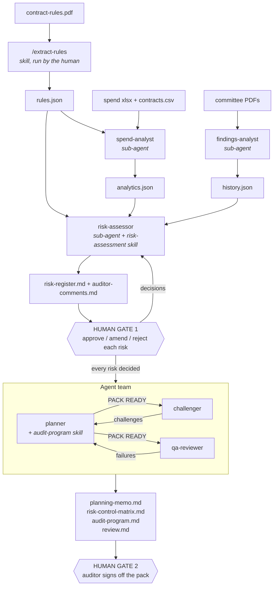

# Procurement Audit Planner

An agent system, built with Claude Code **Skills** and **Agents**, that plans an
internal audit of procurement for West Berkshire Council from its public data.
It turns the council's Contract Rules into testable rules, analyses every
published payment against them, folds in past audit history, rates the risks for
a human auditor to approve, and produces a cross-checked audit planning pack.

This repository is **Part A** of the assignment *Skills, Agents & Deployment*:
a rebuild of the reference application at
<https://procurement-audit-planner.vercel.app/> following its step-by-step guide.

> **Indicators, not accusations.** All data here is public, but it is real.
> Everything under `outputs/` describes *risk indicators to investigate*. Nothing
> in this repository is a finding of wrongdoing by the council, a service, an
> officer or a supplier, and flagged payments should not be quoted out of context.

## Contents

- [The Skills](#the-skills)
- [The Agents](#the-agents)
- [How they work together](#how-they-work-together)
- [Result of the run in this repository](#result-of-the-run-in-this-repository)
- [Confirmation of the guide's steps](#confirmation-of-the-guides-steps)
- [Running it yourself](#running-it-yourself)
- [Repository layout](#repository-layout)

## The Skills

Skills live in `.claude/skills/`. Each is a `SKILL.md` holding a method, plus the
Python that makes the method checkable. The model decides and writes JSON; the
bundled script validates it and renders the documents.

| Skill | Invoked by | Reads | Writes | Bundled script |
| --- | --- | --- | --- | --- |
| [`extract-rules`](.claude/skills/extract-rules/SKILL.md) | The human, with `/extract-rules` | `data/contract-rules.pdf` | `outputs/rules.json` | `verify_quotes.py` checks every verbatim quote against the PDF text |
| [`risk-assessment`](.claude/skills/risk-assessment/SKILL.md) | The `risk-assessor` agent | `rules.json`, `analytics.json`, `history.json` | `outputs/risk-ratings.json` | `build_register.py` validates the ratings and renders `risk-register.md` and `auditor-comments.md` |
| [`audit-program`](.claude/skills/audit-program/SKILL.md) | The `planner` agent | The approved register, the rules and the analytics | `outputs/audit-plan.json` | `build_pack.py` runs the gate check, draws the samples and renders the planning memo, risk-control matrix and audit program |

What each skill enforces:

- **`extract-rules`** – one entry per *testable* rule (a threshold, a required
  action or an approver), each with its clause, page and a copy-exact quote.
  Clauses that cannot be tested go to an `excluded` list with a reason instead of
  being guessed.
- **`risk-assessment`** – likelihood × impact on the council's own 5×5 scoring
  method, taken from its Risk Management Strategy 2024–2027. Every justification
  must cite a rule, a named analytics metric or an audit-history item; a risk
  with no citation is dropped by the builder. The agent recommends; it never
  approves.
- **`audit-program`** – for each approved risk: risk → expected control → test
  step → sample, with the exact payments to pull and a list of documents to
  request from the council. It refuses to run until the auditor has decided every
  risk.

## The Agents

Agents live in `.claude/agents/`. Three are sub-agents launched one at a time by
the main session; three form an agent team that coordinates by messaging each
other.

### Sub-agents (analysis and risk rating)

| Agent | Job | Reads | Writes |
| --- | --- | --- | --- |
| [`spend-analyst`](.claude/agents/spend-analyst.md) | Writes and runs Python that cleans the spend workbooks and the Contracts Finder export, then tests the full population against the thresholds in `rules.json`. Never does arithmetic itself. | `rules.json`, `data/spend/*.xlsx`, `data/contracts.csv` | `scripts/clean.py`, `scripts/analyse.py`, `outputs/analytics.json`, `outputs/analytics-full/` |
| [`findings-analyst`](.claude/agents/findings-analyst.md) | Records the internal audit history, risk themes and the council's risk scoring method, each with a page-level quote. Records only; rates nothing. | `data/committee/*.pdf` | `outputs/history.json` (verified by `scripts/verify_history.py`) |
| [`risk-assessor`](.claude/agents/risk-assessor.md) | Merges the three evidence files into a rated risk register by following the `risk-assessment` skill, and revises it after the auditor's decisions. | `rules.json`, `analytics.json`, `history.json`, `auditor-comments.md` | `outputs/risk-ratings.json` → `risk-register.md`, `auditor-comments.md` |

The `spend-analyst` runs seven tests, all computed by code: threshold
clustering, split purchases, high-value suppliers, off-contract spend,
duplicates, spend after a contract notice has expired, and spend against the
awarded value.

### Agent team (planning pack, after the auditor's approval)

| Agent | Job | Owns |
| --- | --- | --- |
| [`planner`](.claude/agents/planner.md) | Turns the approved risks into the pack using the `audit-program` skill; answers challenges, fixes QA failures and rebuilds. | `outputs/audit-plan.json`, `planning-memo.md`, `risk-control-matrix.md`, `audit-program.md`, `samples/` |
| [`challenger`](.claude/agents/challenger.md) | Challenges the pack against the evidence: ratings or scope that sit oddly with the data (raised for the auditor) and weak samples, controls or tests (raised with the planner). Two rounds at most. | `outputs/challenges.md` |
| [`qa-reviewer`](.claude/agents/qa-reviewer.md) | Runs the four automated checks on every pack version and reports failures exactly as printed. Fixes nothing and softens nothing. | `outputs/review.md` |

The four checks in `scripts/checks/`:

| Check | What it proves |
| --- | --- |
| `check_quotes.py` | Every verbatim quote exists in the Contract Rules PDF |
| `check_numbers.py` | Every figure in the three documents matches a value in the analytics outputs |
| `check_trace.py` | Rule → risk → control → test is complete; every high risk is in scope or its exclusion is justified; no challenge is left open |
| `check_samples.py` | Every sampled transaction exists in the cleaned spend data and the council's workbook |

## How they work together

Each stage writes files that the next stage reads. The agents never pass results
through conversation; the files under `outputs/` are the interface.



1. **Rules.** The human runs `/extract-rules`. The skill writes `rules.json` and
   re-runs its verifier until every quote is found in the PDF.
2. **Evidence.** The main session launches `spend-analyst` and
   `findings-analyst`. One produces what the payments show, the other what past
   audits and the council's own risk method say.
3. **Risk register.** The `risk-assessor` loads the `risk-assessment` skill,
   writes its judgments to `risk-ratings.json` and runs the builder, which fills
   in every figure from `analytics.json` and renders the register.
4. **Human gate 1.** The auditor records a decision on each risk in
   `auditor-comments.md`. The `risk-assessor` is re-run to produce a revision.
   Nothing downstream starts until `build_pack.py --gate` passes.
5. **Agent team.** The main session becomes the lead and spawns the three
   teammates. The planner announces `PACK READY v1`; the challenger and the
   qa-reviewer respond to the planner directly; the planner rebuilds and
   re-announces until challenges are closed and all four checks pass.
6. **Human gate 2.** The auditor reads the challenges marked *for the auditor*
   and completes the sign-off block at the end of `review.md`.

Design rules that hold at every stage:

- **The model reads and judges; Python computes every number.** No agent does
  arithmetic over the data, and no figure in a document is typed by a model.
- **Everything is traceable.** Quotes are verified against the PDFs, every
  metric is reproducible from a script, every rating cites its evidence.
- **Context discipline.** Agents inspect data through aggregates and samples;
  full lists go to `outputs/analytics-full/`, never into a context window.
- **Missing or malformed input means stop and report.** Nothing is invented.

The full specification the agents work from is in [`CLAUDE.md`](CLAUDE.md).

## Result of the run in this repository

The committed `outputs/` folder is one complete run, from the PDF to the signed
pack.

| Stage | Result |
| --- | --- |
| Rules | 72 testable rules extracted from the Contract Rules, 44 clauses excluded with a reason |
| Spend population | 3 monthly workbooks (May–July 2026), 10,607 published rows; 8,534 rows, 1,083 suppliers and £66.8m analysed after logged exclusions |
| Audit history | 20 audits recorded from 4 committee papers, plus the council's 5×5 scoring method |
| Risk register | 11 risks rated (Revision 2) |
| Human gate 1 | 9 approved, 1 likelihood overridden by the auditor (R-09), 1 rejected as out of scope (R-10) → 10 risks in scope |
| Planning pack | Planning memo, risk-control matrix and audit program, with 14 sample files covering 754 distinct transactions |
| Challenges | 6 raised by the challenger, all closed; 2 carried to the auditor |
| QA | All 4 checks pass on pack v2 |
| Human gate 2 | Pack signed off on 2026-10-10 |

Final QA run (`scripts/checks/run_checks.py`):

| Check | Result | What was checked |
| --- | --- | --- |
| quotes | PASS | 51 rules cited in the register, 51 excerpts compared |
| numbers | PASS | 123 figures in 3 documents against 2,487 evidence values |
| trace | PASS | 72 rules (58 cited, 22 listed as not tested); 10 risks in scope; 6 challenges |
| samples | PASS | 754 distinct transactions and 95 row IDs traced to the cleaned data and the workbook |

Where to start reading: [`outputs/planning-memo.md`](outputs/planning-memo.md),
then [`outputs/risk-control-matrix.md`](outputs/risk-control-matrix.md),
[`outputs/audit-program.md`](outputs/audit-program.md) and
[`outputs/review.md`](outputs/review.md).

## Confirmation of the guide's steps

I completed all 27 steps of the guide (5 lessons). The table lists each step and
where its result can be seen in this repository.

| # | Step | Done | Evidence |
| --- | --- | --- | --- |
| – | Prerequisite: VS Code installed | ✅ | – |
| – | Prerequisite: Claude Code installed and signed in | ✅ | – |
| 1.1 | Make a folder, open it, start Claude Code | ✅ | This repository |
| 1.2 | Hand over the project brief | ✅ | `CLAUDE.md` |
| 1.3 | Download the data folder | ✅ | `data/` |
| 1.4 | Set up Python and check the data | ✅ | `requirements.txt` |
| 1.5 | Create the project folders | ✅ | `.claude/`, `scripts/`, `outputs/` |
| 2.1 | Build the `extract-rules` skill | ✅ | `.claude/skills/extract-rules/` |
| 2.2 | Run the skill | ✅ | `outputs/rules.json` |
| 3.1 | Build the `spend-analyst` | ✅ | `.claude/agents/spend-analyst.md` |
| 3.2 | Run the `spend-analyst` | ✅ | `scripts/clean.py`, `scripts/analyse.py`, `outputs/analytics.json`, `outputs/analytics-full/` |
| 3.3 | Build the `findings-analyst` | ✅ | `.claude/agents/findings-analyst.md`, `scripts/verify_history.py` |
| 3.4 | Run the `findings-analyst` and check it | ✅ | `outputs/history.json` |
| 3.5 | Build the `risk-assessment` skill | ✅ | `.claude/skills/risk-assessment/` |
| 3.6 | Build the `risk-assessor` sub-agent | ✅ | `.claude/agents/risk-assessor.md` |
| 3.7 | Run the `risk-assessor` and review the register | ✅ | `outputs/risk-ratings.json`, `outputs/risk-register.md` |
| 4.1 | Open the decision template | ✅ | `outputs/auditor-comments.md` |
| 4.2 | Record your decisions | ✅ | `outputs/auditor-comments.md` (9 approve, 1 override, 1 reject) |
| 4.3 | Revise the register | ✅ | `outputs/risk-register.md` (Revision 2), `outputs/risk-register.state.json` |
| 5.1 | Close the gate | ✅ | `build_pack.py --gate` passes |
| 5.2 | Enable agent teams | ✅ | `.claude/settings.json` |
| 5.3 | Build the `audit-program` skill | ✅ | `.claude/skills/audit-program/` |
| 5.4 | Build the `planner` | ✅ | `.claude/agents/planner.md` |
| 5.5 | Build the `challenger` | ✅ | `.claude/agents/challenger.md` |
| 5.6 | Build the `qa-reviewer` and its checks | ✅ | `.claude/agents/qa-reviewer.md`, `scripts/checks/` |
| 5.7 | Run the team | ✅ | `outputs/audit-plan.json`, the three pack documents, `outputs/samples/`, `outputs/challenges.md` |
| 5.8 | Sign off | ✅ | Sign-off block at the end of `outputs/review.md` |

## Running it yourself

Requirements: [Claude Code](https://claude.com/claude-code), Python 3.11+, and
`pdftotext` (part of poppler: `brew install poppler`).

```bash
git clone https://github.com/SweetVege/procurement-audit-planner.git
cd procurement-audit-planner
python3 -m venv .venv
.venv/bin/pip install -r requirements.txt
```

To re-check the committed pack without running any agent:

```bash
.venv/bin/python scripts/checks/run_checks.py
```

To run the whole flow, start `claude` in the folder and work through it in
order:

1. `/extract-rules`
2. Ask for the `spend-analyst`, then the `findings-analyst`.
3. Ask for the `risk-assessor`, then read `outputs/risk-register.md`.
4. Fill in `outputs/auditor-comments.md` and ask for the `risk-assessor` again.
5. Ask Claude Code to run the agent team.
6. Complete the sign-off block in `outputs/review.md`.

## Repository layout

```
CLAUDE.md                    the brief every agent works from
data/                        public inputs, read-only
  contract-rules.pdf           Contract Procedure Rules (Part 8, Sept 2025)
  spend/*.xlsx                 "Expenditure over £500", three monthly workbooks
  contracts.csv                Contracts Finder notice export
  committee/*.pdf              Governance Committee audit and risk papers
.claude/
  skills/                      extract-rules, risk-assessment, audit-program
  agents/                      the six agents
  agent-memory/                per-agent how-to notes (never evidence)
  settings.json                enables agent teams
scripts/                     Python written by the spend-analyst
  checks/                      the four QA checks and their runner
outputs/                     one complete run (see above)
```

## Data sources

All inputs are published by West Berkshire Council or on the UK government's
Contracts Finder service: the Contract Procedure Rules from the council
constitution, the monthly "Expenditure over £500" workbooks, a Contracts Finder
export of awarded notices, and Governance Committee papers (internal audit
completed-work reports, the Internal Audit Plan 2025–28 and the Risk Management
Strategy 2024–2027). The council's Strategic Risk Register is a confidential
report and is not used.
